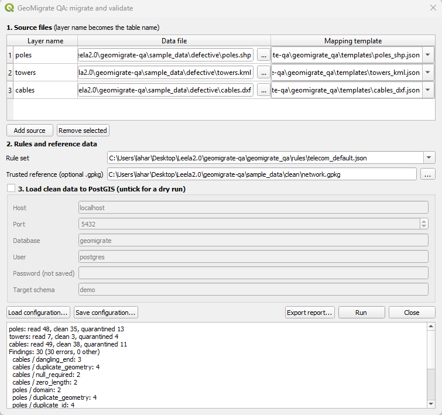
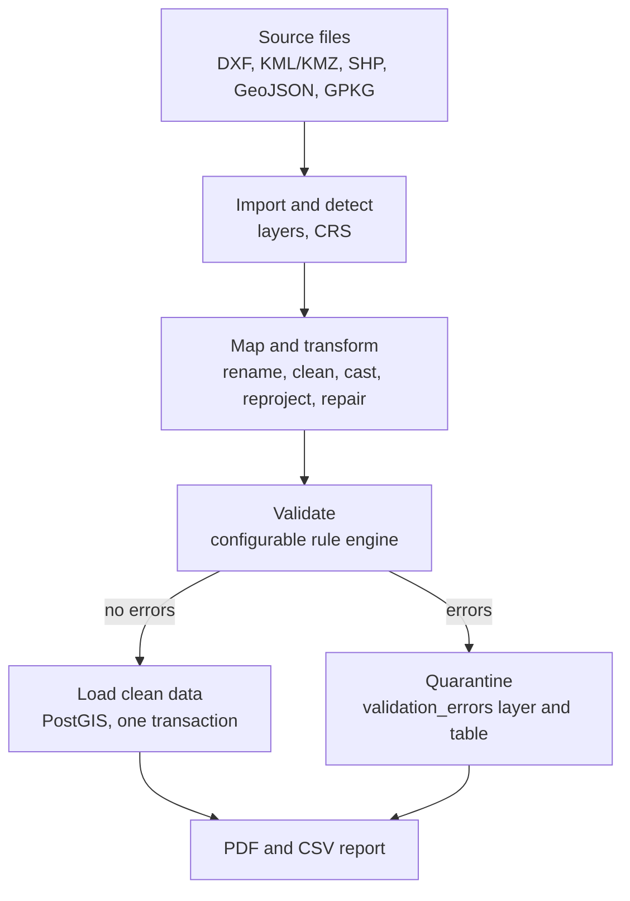
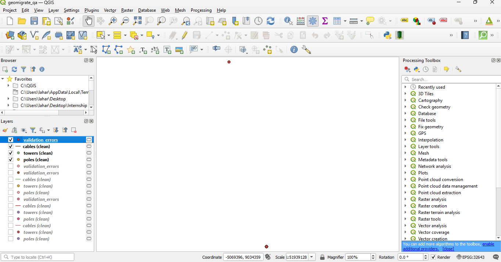
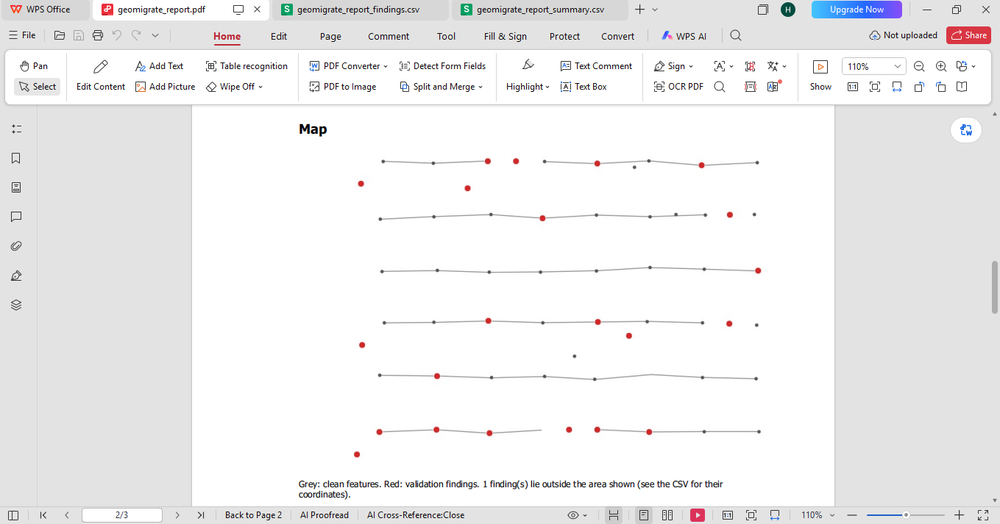

# GeoMigrate QA

[](https://github.com/LeelaLahari/geomigrate-qa/actions/workflows/ci.yml)

A QGIS plugin that migrates messy spatial data (CAD, KML/KMZ, Shapefile, GeoJSON, GeoPackage) into PostGIS, checks it against configurable rules, and writes a PDF/CSV report of everything it found. Clean features are loaded; features with problems are quarantined and listed, never silently dropped or "fixed".

**Status:** experimental. Developed and tested on QGIS 3.44 LTR. Not yet published on plugins.qgis.org.



## Why this exists

Telecom and utility GIS projects usually start with data from many sources: contractor CAD drawings with no coordinate system, KML exports with swapped coordinates, old shapefiles with missing `.prj` files and inconsistent attributes. Someone has to migrate it into a database and prove it is clean. GeoMigrate QA automates that work and leaves an audit trail.

## What it does



- **Imports** DXF, KML, KMZ, Shapefile, GeoJSON and GPKG through QGIS itself, so no extra Python packages are needed. It unzips KMZ, reads sublayers, and reports files that have no CRS instead of guessing.
- **Maps** each source to a target schema using a JSON template: rename fields, clean text, map values (for example DXF layer `CABLE_AERIAL` to cable type `AERIAL`), cast types, compute lengths, reproject to the target CRS, flatten 3D to 2D, and repair invalid geometry when it safely can.
- **Validates** with ten configurable rules (below). Rules only report; they never change data.
- **Loads** to PostGIS by staging, verifying, then swapping into place in a single transaction, with a run log table. If anything fails, the target schema is left exactly as it was.
- **Reports** a PDF (summary, findings by rule, a map of where the problems are, details) and two CSV files.
- Works from a **dialog** and as a **Processing algorithm** (toolbox, batch, Model Builder).



## Validation rules

| Rule                 | Catches                                                          |
| -------------------- | ---------------------------------------------------------------- |
| `null_required`      | Empty required fields                                            |
| `duplicate_id`       | The same ID on several features                                  |
| `domain`             | Values outside an allowed list                                   |
| `range`              | Numbers out of range (for example negative heights)              |
| `duplicate_geometry` | Features in the same place, including a cable drawn backwards    |
| `zero_length`        | Lines with no length                                             |
| `invalid_geometry`   | Broken geometry                                                  |
| `dangling_end`       | Cable ends not connected to any pole or tower                    |
| `out_of_extent`      | Features far outside the expected area (such as swapped lat/lon) |
| `length_mismatch`    | Stored length differs from the real geometry length              |

Each rule has a severity (`error`, `warning`, `info`). Rule sets are JSON files, and a misspelt rule or parameter name is an error, not a silently skipped check.

## Quick start

### 1. Install the plugin

Download `geomigrate_qa-0.1.1.zip` from the [latest release](https://github.com/LeelaLahari/geomigrate-qa/releases/latest), then in QGIS choose _Plugins > Manage and Install Plugins > Install from ZIP_.

To develop the plugin, clone the repository and link the inner `geomigrate_qa` folder into your QGIS profile's plugins folder (see the Development section).

```

Restart QGIS and enable **GeoMigrate QA** in _Plugins > Manage and Install Plugins_. Tick _Show also experimental plugins_ if it is not listed.

### 2. Start PostGIS (optional: needed only to load data)

```

docker run --name geomigrate-db -e POSTGRES_PASSWORD=postgres -e POSTGRES_DB=geomigrate -p 127.0.0.1:5432:5432 -v geomigrate_pgdata:/var/lib/postgresql/data -d postgis/postgis:16-3.4

````

This password is for local development only.

### 3. Run the demo

1. Open _Plugins > GeoMigrate QA > Migrate and validate..._
2. Click **Load configuration...** and choose `sample_data/demo_run.json`.
3. Click **Run** for a dry run, or tick _Load clean data to PostGIS_ (host `localhost`, database `geomigrate`, user and password `postgres`, schema `demo`) and run again.
4. Click **Export report...** to write the PDF and CSV files.

Expected result on the sample data:

| Layer  | Read | Loaded clean | Quarantined |
| ------ | ---- | ------------ | ----------- |
| poles  | 48   | 35           | 13          |
| towers | 7    | 3            | 4           |
| cables | 49   | 38           | 11          |

That is 30 findings, listed in the `validation_errors` layer and table.



## Configuration

A **run configuration** says which files, templates and rules make up one run. Paths are relative to the file; `bundled:` points at templates and rule sets shipped with the plugin. Passwords are never stored.

```json
{
  "label": "demo run",
  "sources": {
    "poles": {
      "file": "defective/poles.shp",
      "template": "bundled:poles_shp.json"
    },
    "cables": {
      "file": "defective/cables.dxf",
      "template": "bundled:cables_dxf.json"
    }
  },
  "rules": "bundled:telecom_default.json",
  "reference_gpkg": "clean/network.gpkg",
  "schema": "demo"
}
````

A **mapping template** turns one source layer into one target layer:

```json
{
  "name": "cables_from_dxf",
  "target_layer": "cables",
  "target_crs": "EPSG:32643",
  "assume_source_crs": "EPSG:32643",
  "geometry_type": "Line",
  "fields": [
    { "target": "cable_id", "source": "EntityHandle", "type": "string" },
    {
      "target": "cable_type",
      "source": "Layer",
      "type": "string",
      "value_map": { "CABLE_AERIAL": "AERIAL", "CABLE_UG": "UG" }
    },
    { "target": "length_m", "type": "double", "compute": "length" }
  ]
}
```

A DXF stores no CRS, so the template states which one to assume. A `reference_gpkg` is a trusted inventory (for example your existing poles and towers) used to check that cable ends connect to real assets.

## The sample data and the answer key

`scripts/generate_sample_data.py` builds a small synthetic telecom network, then breaks it on purpose and records every defect in `sample_data/expected_errors.json`:

- poles as a Shapefile with no `.prj`, duplicate and empty IDs, invalid materials, a negative height and duplicate locations
- towers as KML/KMZ with swapped latitude and longitude, a missing name and a duplicate
- cables as a DXF with no CRS, wrong layers, duplicate and zero-length entities, and dangling ends

The tests compare the rule engine to that answer key. Of the 22 injected defects, 21 are reported by the rules and 1 (a wrongly capitalised material) is corrected by the cleanup step. Running the rules on the clean reference data gives zero findings, which checks for false positives. Running them again on the data that was loaded gives zero findings as well.

## Design decisions

- **Logic lives outside the GUI.** `core/` imports only `qgis.core`, so everything is testable headless. Rule, mapping, run-configuration and report code that needs no QGIS runs in plain Python.
- **Transform is faithful, rules judge.** The transform never drops a feature silently and never invents data. Judging quality is left to the rule engine.
- **Quarantine, don't guess.** Every copy of a duplicate is held back, because the tool cannot know which one is right.
- **Atomic loading.** Stage, verify (row count, SRID, spatial index), then swap in one multi-statement transaction. A test breaks the swap halfway and checks that nothing changed.
- **Safe by default.** Table and schema names are validated before they reach SQL; values are escaped; CSV cells that a spreadsheet could run as formulas are defused; text in the PDF is HTML-escaped.

## Development

```
python -m venv .venv
.venv\Scripts\Activate.ps1
pip install -r requirements-dev.txt -r requirements-data.txt
ruff check .
pytest -q
```

In a normal Python environment, the tests that need QGIS or PostGIS are skipped. To run everything, use QGIS's Python (Windows example) with the database running:

```
& "C:\Program Files\QGIS 3.44.15\bin\python-qgis-ltr.bat" -m pytest -q
```

Database settings come from `GEOMIGRATE_PG_HOST`, `_PORT`, `_DB`, `_USER` and `_PASSWORD` (defaults match the Docker command above).

**CI** (GitHub Actions) runs on every push: lint and the QGIS-free tests on Python 3.10 and 3.12, then the full suite (95 tests) inside the official QGIS 3.44 image against a PostGIS 16 service container.

## Project layout

```
geomigrate_qa/        the plugin
  core/               importer, mapping, transform, rules, PostGIS loader, reports, pipeline
  algorithms/         Processing provider and algorithm
  gui/                the dialog
  templates/  rules/  bundled mapping templates and rule sets
scripts/              sample-data generator
sample_data/          generated test data, answer key, demo run configuration
tests/                unit, QGIS and PostGIS tests
```

## Limitations

- The migration runs on the main thread, so the window can pause on very large files. A background task is the next improvement.
- Tested on QGIS 3.44 LTR. QGIS 4 / Qt6 compatibility has not been tested yet.
- The sample data is synthetic; the rule sets and templates are an example for telecom assets and should be adapted to a real schema.
- The loader writes one target schema per run and replaces tables with the same names when overwrite is on.

## License

GPL-2.0. See `LICENSE`.

## Author

Leela Lahari M
